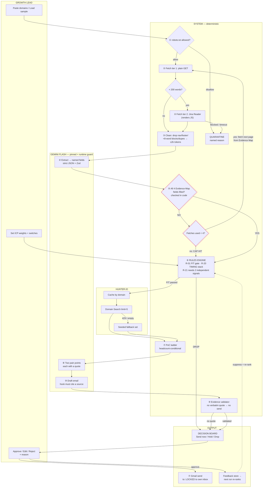

# G3 — Components Map

> Build 2 · Sprinto — "Cold Outreach, at Scale"
> Format follows the faculty map on slide 38: lanes by **Actor**, columns
> **Trigger · Input · Context · Processing · AI · Output**.
> Gate rule: **every box carries a failure mode and a fallback**, and Aayush narrates it in 90 seconds without notes.

---

## 1. The map, in Mesa's swimlane format

| Actor | Trigger | Input | Context | Processing | AI | Output |
|---|---|---|---|---|---|---|
| **Growth Lead** *(user)* | Pastes a list of domains, or clicks **Load sample data** | Domain list (1–20) · ICP weight sliders · feature switches | Her own ICP definition, editable without a password | Reviews the ranked board; **Approve / Edit / Reject** with a reason | — | A triaged board: **Send now / Hold / Drop**, each with a named person, a quoted hook and a ready draft |
| **System** *(the app)* | A run starts; one request per domain | Raw HTML from the company's own pages | Cleaned page text (≤2,000 tokens) + the Evidence Map's four required fields | **① robots.txt gate → ② fetch tier 1/2/3 → ③ heuristic clean → ⑤ field-completeness check (in code) → ⑥ rules engine: FIT gate + TIMING stack → ⑦ PoC ladder → ⑨ evidence validator** | — | Verdict + score + the rule that fired + evidence quotes with live URLs · quarantine rows with named reasons · cost ledger |
| **Hunter.io** *(find contacts)* | Called only when a company clears the FIT gate | Domain | Department filter `executive,it,management`, `limit=5` | Cache lookup first → live call → quota meter | — | Candidate contacts with `first_name`, `position`, `seniority`, `confidence` |
| **AI models** *(Gemini Flash)* | Called at four points only | Cleaned page text; never raw HTML | The named fields it must fill, and nothing else | Strict JSON out, Zod-validated, 1 retry on invalid | **④ extract facts → ⑥a loop decision input → ⑧ two pain points → ⑩ draft the email** | Populated fields · two pain points, each with a verbatim quote · a subject + body whose hook carries a source quote |
| **Gmail** *(send)* | The Growth Lead clicks **Approve & send**, or auto-send switch is ON | The approved draft | `to:` **hardcoded to Aayush's own inbox** — the lock is visible in the UI | `users.messages.send`, base64url RFC-822 | — | Email delivered (and logged in the app) **or** status `send_failed` with the reason shown in red |

**Flow legend (as slide 38):** main flow step-by-step · **conditional flow** = the agent loop, only
when fields are missing · handoff to output = the final result.

---

## 2. The map as Mermaid (for the README, generated from the final code at G8)

**The dashed pink path is the agent loop.** It is the one thing slide 27 says a fixed pipeline
cannot do, and it is the centrepiece of the build.

---

## 3. Every box: failure mode and fallback

| # | Box | Failure mode | Fallback | Visible to the judge as |
|---|---|---|---|---|
| ① | robots.txt gate | File unreachable | **Treat as disallow** | Quarantine row: `robots_unreachable` |
| ② | Fetch tier 1 | JS shell, 404, Cloudflare | → tier 2 Jina Reader → tier 3 **stop** | Per-domain "fetched via: plain / reader / failed" |
| ③ | Clean | Over-cleans, leaves <200 words | Treated as thin signal → triggers the loop | `thin_content` flag on the card |
| ④ | AI extract | Invalid JSON, 429 | 1 retry with the error → OpenRouter transport → **rules-only mode** (regex + keyword) | Orange "rules-only" badge; qualification still runs |
| ⑤ | Field check | — *(this is code, it cannot hallucinate — that's the point)* | — | The "what's still missing" list on the card |
| ⑥ | Loop controller | Would run forever | **Hard cap: 4 extra fetches**, set before the build | Loop trace: every fetch, why it was chosen, what it filled |
| ⑥ | Rules engine | — *(deterministic; same input → same verdict, asserted by a test)* | — | The rule ID that fired, e.g. `R-21: only 1 independent signal` |
| ⑦ | Hunter | 429 quota, stale or empty | Cache → seeded set → **HOLD: PoC unavailable** | Live quota meter; "source: live / cached / seeded" on every PoC |
| ⑦ | PoC ladder | Picks the wrong person | Runner-up always shown with why it lost; one-click swap | Both candidates on the card |
| ⑧ | Pain points | Invented | Must carry a verbatim quote or the literal words **"not stated"** | Quote + live URL under each point |
| ⑨ | Evidence validator | — | **An unquoted hook cannot reach the draft.** Fabrication is blocked before it ships | "Held: hook has no source" |
| ⑩ | Draft | Generic | Hook must name a company-specific fact | The hook's source is one click away |
| ⑦ | Gmail | Token expired, API error | **Fail loudly.** Draft persists, status `send_failed` + reason, red banner | The email card, visibly not sent, with the reason |
| — | Feedback | Goes nowhere | Rejections suppress and re-rank the next run; "What changed because of your feedback" panel | Before/after ordering |

---

## 4. The 6-box spoken version — drill this aloud

> **Trigger → Collect → Loop decides → Rules decide → AI explains → Deliver & learn**

For each box, say three things: **what it does · why this and not the alternative · what happens when it fails.**

**1 · TRIGGER — the Growth Lead gives it a list of domains.**
*What:* she pastes 12 domains, or clicks Load sample, and sets her ICP weights.
*Why not a scheduler:* the brief asks for repeatable, not continuous. A cron is a scheduler, not intelligence — I cut it and said so.
*When it fails:* a bad domain is quarantined with a reason, and the other eleven keep going.

**2 · COLLECT — we read the company's own public pages, cheapest method first.**
*What:* robots.txt first, then a plain request; if fewer than 200 words come back, the page was a JavaScript shell, so we re-fetch through a reader that renders it; if that fails, we stop.
*Why not a headless browser:* ten to fifty times the cost for the same text, and it won't fit in a 10-second serverless function.
*When it fails:* Cloudflare means stop, not fight. The company appears in Quarantine with the reason named.

**3 · LOOP — the model extracts facts into named fields, and my code checks whether they're filled.**
*What:* four questions have to be answered — is it B2B SaaS, is it already certified, what size and stage, is there compliance pressure. The model fills the fields; **code**, not the model, checks whether they're empty, because a model will be confident about a blank page and a field is either populated or it isn't.
*Why it matters:* this is the whole difference between a loop and a fixed pipeline. A fixed pipeline decides in advance what's enough; here the gap decides what we fetch next — a missing stage sends us to the careers page, because that one page answers headcount, seniority and often funding at once.
*When it fails:* the cap is four extra fetches, set before I wrote any code. At the cap the answer isn't "try harder" — it's a handoff: the company becomes **Hold**, with the missing field named.

**4 · RULES DECIDE — deterministic code assigns the verdict, not the model.**
*What:* a fit gate first — B2B SaaS, under 500 people — then a timing score built from stacked signals. "SOC 2 in progress" on their own site is worth 40. A funding round is worth 10, deliberately, because money alone is a press mention. **Send needs 50 points from at least two independent signals**, so one loud signal lands in Hold, not Send.
*Why not let the model score it:* same input must give the same verdict, and I have a test that asserts it. A score I can't reproduce isn't a score.
*When it fails:* it can't drift — but if the ICP is wrong, the weights are sliders and the order re-ranks live.

**5 · AI EXPLAINS — the model reads meaning, never decides.**
*What:* four calls — extract the facts, judge the loop input, find two pain points, draft the email. Every claim carries a verbatim quote and a live URL, or the literal words "not stated".
*Why only here:* rules decide, AI explains. The model is used where meaning has to be read out of messy prose, and nowhere else.
*When it fails:* one retry with the error, then a different transport, then rules-only mode — which still produces the verdict and says on screen that it's running without AI. And a hook with no source quote is blocked before it becomes a draft, so a fabricated hook cannot ship.

**6 · DELIVER AND LEARN — a decision, a person, a draft, and a loop back.**
*What:* she gets a board — Send now, Hold, Drop — with the person named, the runner-up shown, and a draft whose hook is one click from its source. Approve sends it through Gmail to my own inbox, hard-locked in code.
*Why locked:* checks 07 and 08 of the nine. Option C — fully autonomous — failed both, and putting a human at those two steps is literally what turned it into this build.
*When it fails:* Gmail dying doesn't lose the work. The draft persists and the card turns red with the reason. And every Reject carries a reason that suppresses and re-ranks the next run — there's a panel showing what changed because of it.

**Closing line:** *"The failure mode this is designed against is a pipeline that qualifies everything and calls it activity. So watch it drop a company, and watch it tell you why."*

---

## 5. Why this map, not the obvious one

| The obvious map | Ours | Why |
|---|---|---|
| Scrape → AI qualifies → AI writes → send | AI extracts, **code** decides | A model asked "do you have enough information?" will say yes about a blank page (slide 30) |
| Loop until confident | Loop until **named fields are filled**, hard cap 4 | *"A loop without a limit is a cost without a ceiling"* (slide 31) |
| Find a contact | Find a contact **ranked by a headcount-conditional ladder**, runner-up shown | At ≤50 people there is no compliance person — Apty's was Head of People, Zipy's an Engineering Lead |
| Qualify, then email | Qualify, then **validate the evidence**, then email | An unquoted hook is a fabrication waiting to be sent |
