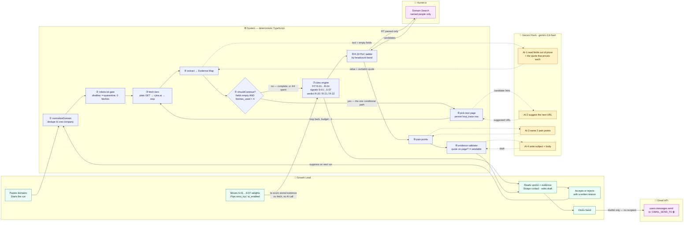

# Signal

An outbound qualification agent for Sprinto. It takes a list of company domains, reads their
public pages, and returns a **Send / Hold / Drop** verdict for each one — with every claim
attached to a verbatim quote and the live URL it came from.

Two rules govern the whole build:

1. **Rules decide, AI explains.** Every verdict, score, gate and completeness check is plain
   TypeScript in `lib/rules/` and `lib/pipeline/completeness.ts`. The model is used only where
   meaning has to be read out of prose — extraction, picking the next page, naming pain points,
   writing the email. No model output is ever allowed to set a verdict.
2. **Never fabricate.** A field is populated only if a verbatim quote from the fetched page
   supports it. Otherwise it renders the literal string `not stated`. This is enforced by Zod
   schemas and `lib/rules/evidenceValidator.ts` — in code, not in a prompt.

---

## How a judge tests it in 2 minutes

| # | Do this | You should see |
|---|---|---|
| 1 | Open `/` | A board with three columns (Send / Hold / Drop). If no run has happened, every panel still says what it is and how to start one — no blank screens. |
| 2 | Click **Start run** | Domains process one per request. The board fills in as each completes. |
| 3 | Open any company | Six sections in order: the verdict and its evidence, the timing signals, **how it decided what to read next**, the point of contact, the pain points, the draft email. |
| 4 | Read section 3 | The agent loop's trace: what was still empty, which page it chose, why, whether AI or fallback chose it, and what that page actually filled. Capped at 4 extra fetches. |
| 5 | Look at the send button | `🔒 to: <GMAIL_SEND_TO> (locked in code)` sits beside it. There is no recipient field anywhere, and `/api/send` has no parameter for one. |
| 6 | Move the **S-06 funding** slider from 10 to 45 | The board re-ranks instantly. No new fetch, no new AI call — re-scoring is pure arithmetic over stored evidence. |
| 7 | Open `/selftest` | 14 golden cases run live against the real rules engine. |
| 8 | Open `/health` | Resolved model id, Hunter quota, AI spend in USD and ₹, cache hit rate. |
| 9 | Open `/quarantine` | Domains refused this run, each with a reason code, plus what changed because of your feedback. |

Every page footer names the resolved model id, so the AI claim is checkable from any screen.

---

## Components Map



Solid arrows are control flow. Dotted arrows are the only four places a model is consulted —
each one hands a suggestion back to deterministic code, which decides whether to keep it.
**⑤ is the single conditional path**: it is the only edge in the diagram that can loop.

---

## The rules

Every rule has an id, and every verdict names the id that produced it.

### FIT gate — `lib/rules/fit.ts`

| ID | Condition | Result |
|---|---|---|
| R-01 | `is_b2b_saas = false` | **DROP** — not B2B SaaS |
| R-02 | `size_band = 500+` | **DROP** — has in-house GRC |
| R-03 | `is_services = true` | **DROP** — services business, not a software product |
| R-04 | `cert_status = certified` | **DROP** if `strict_icp` on; **HOLD** on the migration play if off |

A `null` field never fires a gate. Unknown is unknown, not a reason to drop.

### TIMING signals — `lib/rules/signals.ts`

| ID | Signal | Default weight | Independence group |
|---|---|---|---|
| S-01 | Certification in progress, stated on their own site | 40 | `certification` |
| S-02 | Security/trust page exists with no badge on it | 30 | `certification` |
| S-03 | First security / compliance / GRC hire is open | 30 | `hiring` |
| S-04 | Enterprise logos out of proportion to headcount | 25 | `enterprise-demand` |
| S-05 | Enterprise pricing tier mentions SOC 2, DPA or security review | 15 | `enterprise-demand` |
| S-06 | Recent funding round | 10 | `funding` |
| S-07 | Sells into a regulated vertical | 15 | `vertical` |

S-01 and S-02 share a group deliberately: they are two readings of the same page, so stacking
them must not manufacture a second independent signal. Weights are adjustable 0–50 from the
board; a signal at weight 0 keeps its evidence but contributes nothing.

### Verdict — `lib/rules/verdict.ts`

| ID | Condition | Verdict |
|---|---|---|
| R-20 | score ≥ 50 **and** independent groups ≥ 2 | **SEND** |
| R-21 | score ≥ 50 **but** only 1 independent group | **HOLD** |
| R-20 | 20 ≤ score < 50 | **HOLD** |
| R-20 | score < 20 | **DROP** — fit passed, no timing signal |
| R-22 | 4/4 fetches spent and a required field is still `not stated` | **HOLD** — hand off rather than guess |

R-22 never touches a fit-gate DROP: an evidenced rejection is not made uncertain by a gap.

### Point of contact — `lib/rules/poc.ts`

R-30 is a headcount-conditional ladder. Generic mailboxes (`info@`, `support@`) are rank 99 and
can never be selected — not by the ladder, and not by the swap endpoint either, which refuses
them server-side with a 409.

| Band | Rung 1 | Rung 2 | Rung 3 |
|---|---|---|---|
| 1-10, 11-50 | CTO / Co-founder / Head of Eng | Head of People / Ops | VP Sales |
| 51-200 | Head of Security / GRC / Compliance | CTO / VP Engineering | Head of People / COO |
| 201-500 | Head of Security / GRC / Compliance | VP Engineering | Head of Legal |
| 500+ | *(unreachable — R-02 drops first)* | | |

A `null` band uses the 51-200 ladder: the middle rung, and the least wrong guess. If no named
person exists, R-30 refuses to select one and the company becomes a HOLD — there is nobody to
send to.

---

## AI compliance note

**Every AI task in this application runs on Gemini Flash, pinned to `gemini-3.8-flash`.
The Claude API is not used anywhere in the product code.**

- The id is a `const` in `lib/ai/model.ts`, not an environment variable. *Pin* means pin.
- A runtime guard throws `ModelGuardError` if a resolved id does not start with `gemini-`, so a
  future edit that swaps in another vendor fails loudly at the first call rather than quietly
  changing what the footer claims.
- The OpenRouter fallback is a **transport** fallback only. It reaches the same model through
  `google/gemini-3.8-flash`, and the slug is mapped back to a bare id and re-guarded before use.
- The build originally pinned `gemini-2.0-flash`. Google has since retired it *and* `2.5-flash`
  — the API returns 404 naming `gemini-3.8-flash` as the replacement — so the pin was moved. A
  floating alias like `gemini-flash-latest` would survive the next retirement, but it would make
  the footer a claim about whatever shipped that morning. Pinning means re-pinning deliberately.
- The resolved id is rendered in the footer of every page and written to every `cost_ledger` row,
  so the claim is auditable from the UI and from the database independently.
- With `GEMINI_API_KEY` unset the app still starts and runs rules-only, with an orange banner on
  screen saying so. It never silently substitutes another model.

The four calls: **AI-1** extraction (reads fields out of prose, must return a verbatim quote per
field), **AI-2** next-page suggestion, **AI-3** pain points, **AI-4** draft. AI-1's output is
validated by Zod — a populated field with no quote is rejected and retried exactly once with the
rejection reason fed back. A second failure falls through to rules-only extraction rather than
accepting an ungrounded answer.

---

## Running it

```bash
npm install
npm run dev     # http://localhost:3000
npm run test    # 91 tests
npm run build
```

No login, no password, no paywall. With zero credentials set, the app boots an in-memory PGlite
database and runs rules-only — every page is usable, every banner explains what is degraded.
`.env.example` documents all 12 variables. `GMAIL_SEND_TO` is the one the app refuses to send
without.

---

## Known limits

- **PGlite is in-memory.** Without `DATABASE_URL` the data is lost on restart, and on Vercel it
  resets per invocation. `/health` shows a red banner whenever that driver is active. Production
  needs Neon.
- **Rules-only extraction is keyword matching.** It is genuinely evidence-bound — no quote, no
  value — but its recall is well below AI-1's. Fields it cannot read stay `not stated` and the
  verdict is a HOLD under R-22, which is the correct failure direction but produces few Sends.
  A rules-only run will skew Hold/Drop.
- **The 4-fetch cap is a budget, not a guarantee.** A site that hides headcount and compliance
  behind JavaScript or a login will exhaust the cap and hand off. That is deliberate — R-22
  hands off rather than guessing — but it means some qualified companies arrive as Holds.
- **Signal detection is English-only** and regex-based. Non-English pages and unusual phrasing
  will under-fire rather than misfire, which is the safer direction but still a miss.
- **One domain per HTTP request** to stay inside Vercel's 10s Hobby limit. A long list is
  therefore many round trips; the board streams in rather than arriving at once.
- **Hunter.io gives email candidates, not verified seniority.** The ladder ranks on title
  strings, so an unusual title lands off-ladder and the runner-up reason will say so.
- **T-20 is not met on the §4.2 sample set: the live run produced no Send.** With live Gemini
  and Hunter keys the 12 seeded entries collapse to 10 companies — 3 quarantined, 7 scored —
  and all 7 came back Hold at default settings. The cause is measured, not guessed: 6 of the 7
  never state a headcount on any page the loop could reach, so `size_band` stays `not stated`
  and **R-22 converts the Send into a handoff**. `nected.ai` reaches a Send-qualifying score of
  55 across 2 independent groups and is still held, by R-22, for exactly that reason. Turning
  `strict_icp` on produces the Drop column (rocketlane.com and zipy.ai, both R-04 — already
  certified), so Hold and Drop are demonstrated and only Send is not. Loosening R-22 would turn
  T-20 green in a minute, and that is the fabricated verdict §1 forbids: a Send issued on an
  unknown headcount is a guess wearing a rule number. The gap is reported, not tuned away.
  See D-22.
