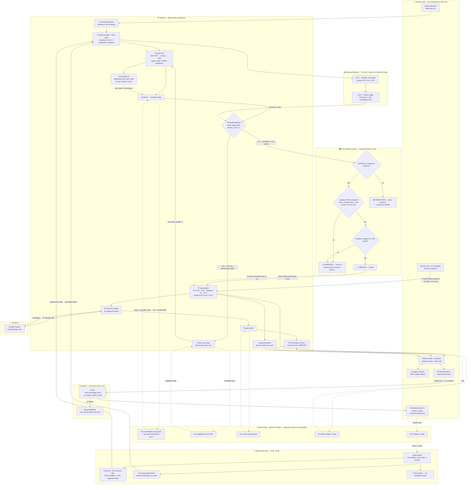

# Signal

An outbound qualification agent for Sprinto. It takes a list of company domains, reads their
public pages, and returns a **Send / Hold / Drop** verdict for each one — with every claim
attached to a verbatim quote and the live URL it came from.

Two rules govern the whole build:

1. **Rules decide, AI explains.** Every verdict, score, gate and completeness check is plain
   TypeScript in `lib/rules/` and `lib/pipeline/completeness.ts`. The model is used only where
   meaning has to be read out of prose — extraction, picking the next page, naming pain points,
   writing the email. No model output is ever allowed to set a verdict.
2. **Never fabricate.** A field is populated only if a verbatim quote from the fetched page
   supports it. Otherwise it renders the literal string `not stated`. This is enforced by Zod
   schemas and `lib/rules/evidenceValidator.ts` — in code, not in a prompt.

---

## How a judge tests it in 2 minutes

| # | Do this | You should see |
|---|---|---|
| 1 | Open `/` | A board with three columns (Send / Hold / Drop). If no run has happened, every panel still says what it is and how to start one — no blank screens. |
| 2 | Click **Start run** | Domains process one per request. The board fills in as each completes. |
| 3 | Open any company | Six sections in order: the verdict and its evidence, the timing signals, **how it decided what to read next**, the point of contact, the pain points, the draft email. |
| 4 | Read section 3 | The agent loop's trace: what was still empty, which page it chose, why, whether AI or fallback chose it, and what that page actually filled. Capped at 4 extra fetches. |
| 5 | Look at the send button | `🔒 to: <GMAIL_SEND_TO> (locked in code)` sits beside it. There is no recipient field anywhere, and `/api/send` has no parameter for one. |
| 6 | Move the **S-06 funding** slider from 10 to 45 | The board re-ranks instantly. No new fetch, no new AI call — re-scoring is pure arithmetic over stored evidence. |
| 7 | Open `/selftest` | **26 assertions, split in two.** Structural cases run on frozen inputs; behavioural ones read the live database — including T-20, which asserts the board really produces ≥1 Send, ≥2 Drop and ≥1 Hold. |
| 8 | Open `/health` | The R-23 counter — *N claims downgraded to asserted · M fabrications blocked* — with a drill-down naming every refused quote and why. Then the model id, Hunter quota, and what the run cost against what it saved. |
| 9 | Open `/quarantine` | Domains refused this run, each with a reason code, plus what changed because of your feedback. |
| 10 | Open any card's **What would move this** | A computed next step, not a template: which signal is missing, what it is worth at the current weights, and whether we already looked for it. Finished questions say *"Settled"* instead. |
| 11 | Open `/replies` | Paste a reply. The model's reading and the rule it triggers appear side by side. Nothing is applied until you confirm — and R-54, the only irreversible action, needs a typed phrase. |

Every page footer names the resolved model id, so the AI claim is checkable from any screen.

---

## Components Map



Solid arrows are control flow. Dotted arrows are the only five places a model is consulted —
each one hands a suggestion back to deterministic code, which decides whether to keep it.
**⑤ is the single conditional path**: it is the only edge in the diagram that can loop.

Three things in the diagram are worth reading twice:

- **The reserved fetches sit outside the loop.** Two of the four extra fetches are spent before
  the model is asked anything. The cap did not change; who spends it did.
- **R-23 is a gate, not a label.** Nothing reaches the score without passing all three of its
  questions, and the `ASSERTED` path is drawn dotted into the rules engine because it arrives
  carrying zero points — it is shown, not counted.
- **There are two human checkpoints, not one.** Approve-and-send is the obvious one. The reply
  loop is the second, and its quote guard sits in front of the rules for the same reason R-23
  does: the one irreversible action in this system must not be reachable by inference.

---

## The rules

Every rule has an id, and every verdict names the id that produced it.

### FIT gate — `lib/rules/fit.ts`

| ID | Condition | Result |
|---|---|---|
| R-01 | `is_b2b_saas = false` | **DROP** — not B2B SaaS |
| R-02 | `size_band = 500+` | **DROP** — has in-house GRC |
| R-03 | `is_services = true` | **DROP** — services business, not a software product |
| R-04 | `cert_status = certified` | **DROP** if `strict_icp` on; **HOLD** on the migration play if off |

A `null` field never fires a gate. Unknown is unknown, not a reason to drop.

### TIMING signals — `lib/rules/signals.ts`

| ID | Signal | Default weight | Independence group |
|---|---|---|---|
| S-01 | Certification in progress, stated on their own site | 40 | `certification` |
| S-02 | Security/trust page exists with no badge on it | 30 | `certification` |
| S-03 | First security / compliance / GRC hire is open | 30 | `hiring` |
| S-04 | Enterprise logos out of proportion to headcount | 25 | `enterprise-demand` |
| S-05 | Enterprise pricing tier mentions SOC 2, DPA or security review | 15 | `enterprise-demand` |
| S-06 | Recent funding round | 10 | `funding` |
| S-07 | Sells into a regulated vertical | 15 | `vertical` |

S-01 and S-02 share a group deliberately: they are two readings of the same page, so stacking
them must not manufacture a second independent signal. Weights are adjustable 0–50 from the
board; a signal at weight 0 keeps its evidence but contributes nothing.

### Verdict — `lib/rules/verdict.ts`

| ID | Condition | Verdict |
|---|---|---|
| R-20 | score ≥ 50 **and** independent groups ≥ 2 | **SEND** |
| R-21 | score ≥ 50 **but** only 1 independent group | **HOLD** |
| R-20 | 20 ≤ score < 50 | **HOLD** |
| R-20 | score < 20 | **DROP** — fit passed, no timing signal |
| R-22 | 4/4 fetches spent and a required field is still `not stated` | **HOLD** — hand off rather than guess |
| R-23 | signals fired, but none of them survived the evidence check | **DROP** — nothing here is supported |

R-22 never touches a fit-gate DROP: an evidenced rejection is not made uncertain by a gap.

### Evidence tiers — `lib/rules/evidenceTier.ts`

R-23 exists because a verbatim match is a weaker test than it looks. Four real quotes from a
production run passed the old validator and should not have: an industry statistic, a staff
bio dating something to *before* the company existed, a cookie banner, and a Jina Reader error
page. Every one of them is genuinely present in the fetched text.

So a quote is scored only when three things hold, all checked in code:

| Tier | Condition | Behaviour |
|---|---|---|
| `verified` | verbatim in fetched text **and** mentions the company (name, domain stem, or first person on its own page) **and** contains a trigger term for the signal it is attached to | scores normally |
| `asserted` | verbatim, but fails one of the two support tests | **scores 0**, excluded from R-21, shown greyed with the reason |
| `fabricated` | not verbatim on any page fetched for this company | never rendered as evidence; draft blocked; counted on `/health` |

Naming the company is necessary but not sufficient: a quote that names it only to date something
to *before* it ("Prior to Zipy, …") or to attribute the claim to someone else ("according to …")
is still asserted. The same three tiers apply to signals, pain points and the draft hook, and the
hook must be `verified` for the draft to be sendable at all — including after an edit.

Every refusal is written to `evidence_blocks` and counted on `/health` as *N claims downgraded to
asserted · M fabrications blocked this run*, with a drill-down. A block nobody can see is
indistinguishable from a check that never ran.

### Reserved fetches — `lib/fetch/plan.ts`

The budget is **four extra fetches per company and it did not change.** What changed is who
spends them.

| Slot | Kind | Target | Why it is not the model's to skip |
|---|---|---|---|
| 1 | reserved | security / trust page | Carries S-01, S-02 and S-03 — the largest block of points available |
| 2 | reserved | careers page | Answers headcount *and* the first-compliance-hire signal in one request |
| 3–4 | discretionary | AI-2's choice | The model picks from same-host links it can actually see |

Before this, all four slots were the model's, and it reliably spent them on pages that read well
and scored nothing — an about page, a blog index, a pricing page already covered by the homepage.
The signals were on the pages it did not pick. Raising the cap would have bought more of the same
choice; reserving two changed the choice itself.

Two consequences worth stating plainly:

- **A reserved fetch is spent even when it fails.** rocketlane.com has no careers page at any
  address we can guess — `/careers`, `/jobs`, `/about/careers` and `/company/careers` all 404 —
  and that absence is recorded in the loop trace as a finding rather than silently retried.
- **Reserved slot 1 is never skipped by the deadline guard.** It runs before the discretionary
  loop, so a slow company loses its *optional* reading, never its security page.

`R-02c` is the rule that makes this honest: when headcount stays unknown after all of it, that
**does not gate the verdict**. It is reported on the card and named in the counterfactual, but it
is not allowed to overrule verified evidence. See `D-41`.

---

### Reply intents — `lib/rules/replyIntent.ts`

The second human checkpoint. AI-5 classifies a pasted reply; the rules below decide what that
means; nothing is applied until a human confirms it.

| Rule | Intent | What it does | Reversible |
|---|---|---|---|
| R-50 | `interested` | Mark won, stop further outreach, surface in "what changed" | yes |
| R-51 | `not_now` | Snooze 90 days — **not** suppressed, stays on the board with a return date | yes, automatically |
| R-52 | `wrong_person` | Re-run the contact ladder excluding that person, promote the runner-up | yes |
| R-53 | `not_interested` | Suppress 180 days with the reason recorded | yes, automatically |
| R-54 | `unsubscribe` | **Permanent block.** Quarantined before any fetch on every future run | **no** |
| R-55 | `unclear` | Nothing automatic. The model's reading is shown as a suggestion only | n/a |

**The quote guard runs before any of this.** AI-5 must return a sentence that appears verbatim in
the pasted reply. If it does not, the intent is forced to `unclear` — which is the one intent
with no consequence attached. So an *inferred* unsubscribe cannot reach R-54: the sender has to
have actually written something that says so.

R-54 additionally requires the phrase `BLOCK PERMANENTLY` to be typed, and that check runs
server-side as well as in the browser. A domain already blocked cannot be moved to any other
state by a later reply. The asymmetry is deliberate: the error that matters is contacting
someone who opted out, not failing to re-contact someone who did.

---

### What the economics panel measures, and what it assumes

`/health` ends with **"What this run cost, and what it saved"**, split in two because the two
halves are different kinds of claim.

**Measured** — read from the run's own `cost_ledger`, `fetches` and `companies` rows:

- AI spend in USD and ₹ · model calls and cache hits · Hunter credits used and remaining
- Cost per company qualified · cost per Send · wall-clock elapsed

**Estimated** — arithmetic on a baseline *you* supply, defaulting to 15 minutes per company and
editable on screen:

- Hours saved this run · cost per hour saved

Every estimated figure is individually tagged `(estimate)`, and the panel renders this sentence
verbatim beneath them:

> The measured numbers above come from the run's own ledger. The saved-time figure is an estimate
> built on the baseline you can edit — it is an assumption, not a measurement.

`tests/economics.test.ts` asserts that exact string, because a disclaimer that can be quietly
reworded in a later edit is not a safeguard. The baseline is deliberately **not persisted**:
saving a borrowed assumption is how it starts reading like a measured fact.

---

### Point of contact — `lib/rules/poc.ts`

R-30 is a headcount-conditional ladder. Generic mailboxes (`info@`, `support@`) are rank 99 and
can never be selected — not by the ladder, and not by the swap endpoint either, which refuses
them server-side with a 409.

| Band | Rung 1 | Rung 2 | Rung 3 |
|---|---|---|---|
| 1-10, 11-50 | CTO / Co-founder / Head of Eng | Head of People / Ops | VP Sales |
| 51-200 | Head of Security / GRC / Compliance | CTO / VP Engineering | Head of People / COO |
| 201-500 | Head of Security / GRC / Compliance | VP Engineering | Head of Legal |
| 500+ | *(unreachable — R-02 drops first)* | | |

A `null` band uses the 51-200 ladder: the middle rung, and the least wrong guess. If no named
person exists, R-30 refuses to select one and the company becomes a HOLD — there is nobody to
send to.

---

## AI compliance note

**Every AI task in this application runs on Gemini Flash, pinned to `gemini-3.8-flash`.
The Claude API is not used anywhere in the product code.**

- The id is a `const` in `lib/ai/model.ts`, not an environment variable. *Pin* means pin.
- A runtime guard throws `ModelGuardError` if a resolved id does not start with `gemini-`, so a
  future edit that swaps in another vendor fails loudly at the first call rather than quietly
  changing what the footer claims.
- The OpenRouter fallback is a **transport** fallback only. It reaches the same model through
  `google/gemini-3.8-flash`, and the slug is mapped back to a bare id and re-guarded before use.
- The build originally pinned `gemini-2.0-flash`. Google has since retired it *and* `2.5-flash`
  — the API returns 404 naming `gemini-3.8-flash` as the replacement — so the pin was moved. A
  floating alias like `gemini-flash-latest` would survive the next retirement, but it would make
  the footer a claim about whatever shipped that morning. Pinning means re-pinning deliberately.
- The resolved id is rendered in the footer of every page and written to every `cost_ledger` row,
  so the claim is auditable from the UI and from the database independently.
- With `GEMINI_API_KEY` unset the app still starts and runs rules-only, with an orange banner on
  screen saying so. It never silently substitutes another model.

The four calls: **AI-1** extraction (reads fields out of prose, must return a verbatim quote per
field), **AI-2** next-page suggestion, **AI-3** pain points, **AI-4** draft. AI-1's output is
validated by Zod — a populated field with no quote is rejected and retried exactly once with the
rejection reason fed back. A second failure falls through to rules-only extraction rather than
accepting an ungrounded answer.

---

## Running it

```bash
npm install
npm run dev     # http://localhost:3000
npm run test    # 91 tests
npm run build
```

No login, no password, no paywall. With zero credentials set, the app boots an in-memory PGlite
database and runs rules-only — every page is usable, every banner explains what is degraded.
`.env.example` documents all 12 variables. `GMAIL_SEND_TO` is the one the app refuses to send
without.

---

## Known limits

- **PGlite is in-memory.** Without `DATABASE_URL` the data is lost on restart, and on Vercel it
  resets per invocation. `/health` shows a red banner whenever that driver is active. Production
  needs Neon.
- **Rules-only extraction is keyword matching.** It is genuinely evidence-bound — no quote, no
  value — but its recall is well below AI-1's. Fields it cannot read stay `not stated` and the
  verdict is a HOLD under R-22, which is the correct failure direction but produces few Sends.
  A rules-only run will skew Hold/Drop.
- **The 4-fetch cap is a budget, not a guarantee.** It did not change; two of the four slots are
  now reserved (security page, careers page) and only two are the model's to choose. A site that
  hides headcount behind JavaScript or a login still exhausts the cap — but under R-02c an
  unknown headcount no longer converts a qualified company into a handoff.
- **Signal detection is English-only** and regex-based. Non-English pages and unusual phrasing
  will under-fire rather than misfire, which is the safer direction but still a miss.
- **One domain per HTTP request** to stay inside Vercel's 10s Hobby limit. A long list is
  therefore many round trips; the board streams in rather than arriving at once.
- **Hunter.io gives email candidates, not verified seniority.** The ladder ranks on title
  strings, so an unusual title lands off-ladder and the runner-up reason will say so.
- **T-20 is met, and it is the only reason the board is worth reading.** The live run produces
  **1 Send · 4 Hold · 4 Drop** across 9 scored companies, and `/selftest` asserts it against the
  live database rather than a fixture — if the pipeline stops producing Sends, that assertion
  goes red on the next page load. The earlier writeup of this as a principled limit was wrong:
  the cause was `R-22` re-imposing the gate that `R-02c` had just removed, so an unknown
  headcount still decided outcomes under a different rule number. See D-41.
- **R-23 cost the board its original Send, and that was the correct outcome.** `nected.ai`
  scored SEND/70 before evidence tiering on three quotes that name nobody — navigation chrome
  (`"Home Use Cases Compliance and Auditing for Healthcare"`), a G2 rating label, and a
  use-case blurb. It is now DROP/0 under R-23. The Send on the board today is `rocketlane.com`,
  whose three signals are all `verified`. Loosening the mention test would restore the old
  number and destroy the thing the number was supposed to mean. See D-39.
- **No fabrication has been caught in production.** `/health` reads *"18 claims downgraded to
  asserted · 0 fabrications blocked this run"*, and that zero is honest rather than broken:
  every bad quote found so far was real text that failed the *support* test, not invented text.
  The fabricated path has unit coverage and has not fired on a live run.
- **Sending is wired but unproven.** The Gmail → Resend chain, the per-transport send rows and
  the subject-line rule R-40 are all in place and tested, but `GOOGLE_CLIENT_ID`,
  `GOOGLE_CLIENT_SECRET`, `GOOGLE_REFRESH_TOKEN` and `RESEND_API_KEY` are not set, so **no real
  email has been sent from this deployment.** The card will report the failure rather than
  pretend. This is the one acceptance criterion in the brief that is not demonstrated.
- **The size-inference ceiling is a fact about the web, not a tuning choice.** `rocketlane.com`
  publishes no careers page at any guessable address, so its headcount stays unknown. Under
  R-02c that is disclosed on the card and named in the counterfactual — *if they turn out to be
  above 500 they have in-house GRC and this becomes a Drop* — rather than being guessed or being
  allowed to overrule three verified signals.
